# PDM Aula 14 — Geolocalização e GPS

Roteiro prático da disciplina **Programação para Dispositivos Móveis I** (Semestre 2026/2) —
Aula 14: *Sensores do Celular, Permissões e Coordenadas*.

Tela de **Check-in & GPS** que lê a posição do aparelho com o pacote oficial
[`geolocator`](https://pub.dev/packages/geolocator). Antes de cada busca, o app confere se o GPS
está ligado e pede a permissão de localização ao sistema. Depois mostra latitude, longitude,
precisão e altitude. Dá para capturar a posição uma vez (`getCurrentPosition`) ou acompanhar o
deslocamento em tempo real (`getPositionStream`).

## Arquitetura

| Diretório / Arquivo | Responsabilidade | Conceitos aplicados |
|---|---|---|
| `lib/services/location_service.dart` | Único ponto de acesso ao GPS: validações, captura única, stream e distância | `isLocationServiceEnabled`, `checkPermission`/`requestPermission`, `getCurrentPosition`, `getPositionStream`, `distanceBetween`, `LocationSettings` |
| `lib/services/mapa_service.dart` | Monta o link do Google Maps e abre fora do app | `url_launcher`, `launchUrl` com `LaunchMode.externalApplication` |
| `lib/screens/geolocalizacao_screen.dart` | Card de coordenadas, loading, erros e botões de captura e rastreamento | `StatefulWidget`, `StreamSubscription`, `dispose`, `SnackBar`, `LayoutBuilder` |
| `lib/widgets/indicador_precisao.dart` | `Chip` verde, amarelo ou vermelho conforme a precisão | `enum` com cor, rótulo e ícone |
| `lib/utils/fatec_matao.dart` | Coordenadas da Fatec Matão | Constantes |
| `lib/utils/formatar_distancia.dart` | Distância no padrão brasileiro (`12.438 m (≈ 12,4 km)`) | Separador de milhar sem pacote extra |
| `lib/main.dart` | `MaterialApp` com Material 3 | `ThemeData(colorSchemeSeed:)` |

```
lib/
├── main.dart
├── screens/
│   └── geolocalizacao_screen.dart
├── services/
│   ├── location_service.dart
│   └── mapa_service.dart
├── utils/
│   ├── fatec_matao.dart
│   └── formatar_distancia.dart
└── widgets/
    └── indicador_precisao.dart
```

### Permissões declaradas

| Plataforma | Arquivo | Declaração |
|---|---|---|
| Android | `android/app/src/main/AndroidManifest.xml` | `ACCESS_FINE_LOCATION` (GPS) e `ACCESS_COARSE_LOCATION` (rede), dentro de `<manifest>`; `<queries>` para links `https` (Desafio Avançado) |
| iOS | `ios/Runner/Info.plist` | `NSLocationWhenInUseUsageDescription` com o texto mostrado no diálogo do sistema |
| Web | — | O navegador pede a permissão sozinho na primeira busca |

### Fluxo da captura

1. **Capturar Localização Atual** liga o loading e desabilita o botão.
2. `LocationService` confere o GPS (`isLocationServiceEnabled`) e a permissão. Se ela estiver
   `denied`, chama `requestPermission()`, que abre o diálogo nativo. Se continuar negada, ou se for
   `deniedForever`, lança uma `Exception` com a mensagem do roteiro.
3. Com tudo liberado, `getCurrentPosition` devolve um `Position`. O card mostra as coordenadas, a
   precisão, a altitude e os desafios.
4. **Iniciar Rastreamento Contínuo** escuta `getPositionStream` (precisão alta, `distanceFilter` de
   10 m). Cada posição nova atualiza o card. **Parar** cancela a `StreamSubscription`, e o `dispose`
   também cancela ao sair da tela.

## Desafios de laboratório implementados

O roteiro pede um nível. Os três foram resolvidos:

| Nível | Desafio | Implementação |
|---|---|---|
| **Básico** | Medidor de Precisão | `IndicadorPrecisao` classifica `Position.accuracy`: `Chip` **verde** abaixo de 15 m, **amarelo** de 15 a 50 m e **vermelho** acima de 50 m. Mostra o rótulo e o valor (`Precisão alta · 5.0 m`) e muda de cor a cada posição do stream |
| **Intermediário** | Cálculo de Distância | `LocationService.distanciaAteFatec` chama `Geolocator.distanceBetween(lat1, lng1, lat2, lng2)` até a Fatec Matão. A distância é recalculada a cada posição e aparece em metros, com km entre parênteses a partir de 1.000 m |
| **Avançado** | Abrir no Google Maps | Botão **Abrir no Mapa** no card. `MapaService` monta `https://maps.google.com/?q=lat,lng` e chama `launchUrl` com `LaunchMode.externalApplication`. Abre o app do Maps no celular ou uma aba nova no navegador. Se nenhum app abrir o link, um `SnackBar` avisa |

**Coordenadas da Fatec Matão:** `-21.617690, -48.362309`. Vêm do mapa incorporado na
[página oficial da unidade](https://www.cps.sp.gov.br/fatecs/fatec-matao-luiz-marchesan/) no site
do Centro Paula Souza (Av. Habib Gabriel, 1360 — Residencial Olívio Benassi). Ao abrir esse ponto
no Maps, o endereço mostrado é no Residencial Olívio Benassi, o bairro da Fatec (print 07).

## Evidências

Capturas do app rodando no **emulador Android** (Pixel 7, API 35). O GPS do emulador foi movido
com `adb emu geo fix <longitude> <latitude>`, primeiro num ponto do centro de Matão
(`-21.6033, -48.3658`) e depois em passos até a Fatec. Os diálogos do sistema aparecem em inglês
porque é o idioma padrão do emulador.

| Tela inicial | Diálogo de permissão | Permissão negada |
|---|---|---|
| 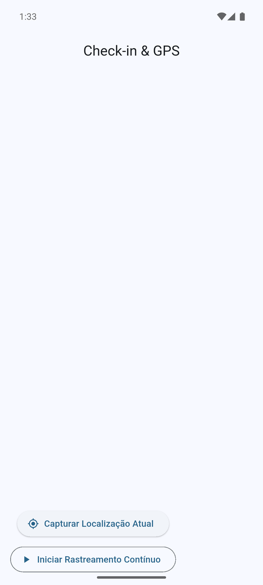 | 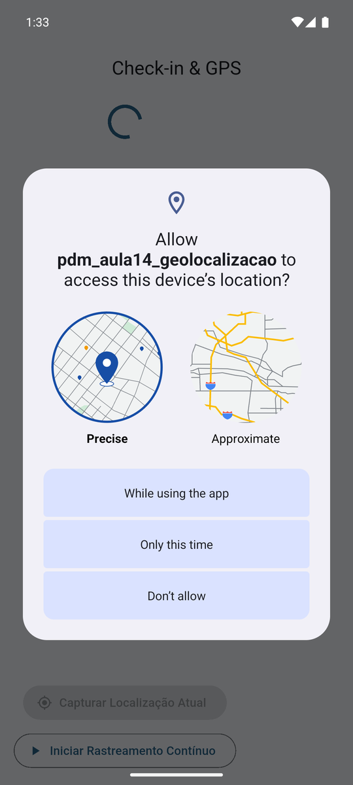 | 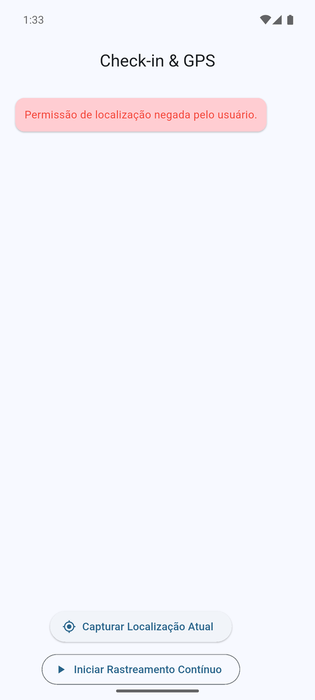 |
| Só os botões, antes da primeira busca | `requestPermission()` abre o diálogo nativo, com o loading atrás | **Don't allow**: a `Exception` do serviço vira o card vermelho |

| Coordenadas capturadas | Rastreamento em andamento | Chegada à Fatec |
|---|---|---|
| 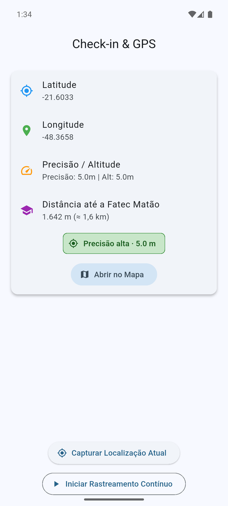 | 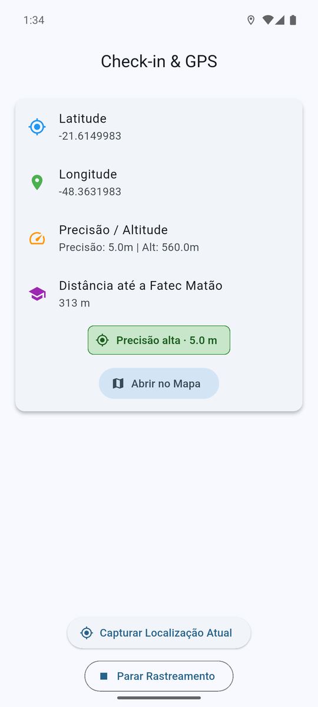 | 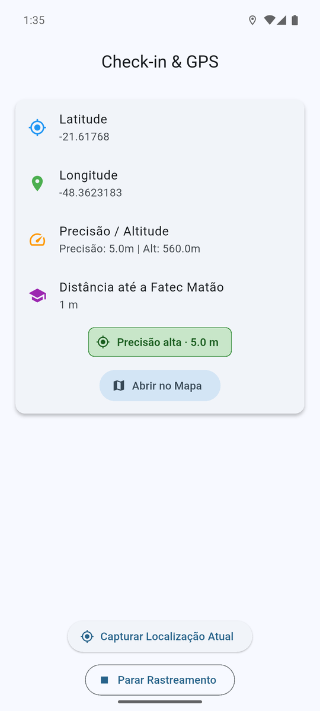 |
| Precisão de 5 m: Chip **verde**. Distância de 1.642 m até a Fatec | Cada `geo fix` chega pelo stream: a distância caiu de 1.642 m para 313 m | No ponto da Fatec a distância chega a 1 m |

| Avançado — Google Maps | Básico — localização aproximada |
|---|---|
| 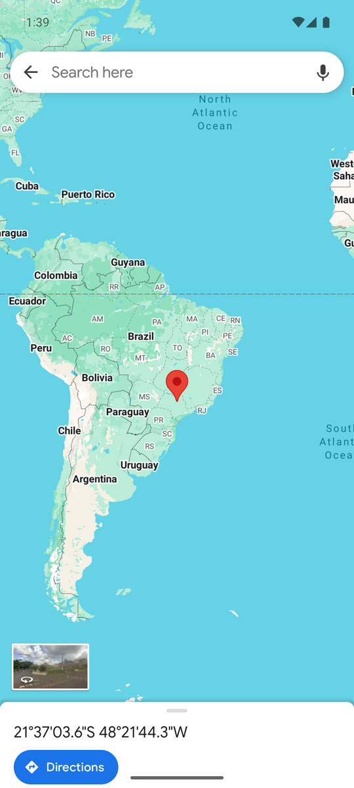 | 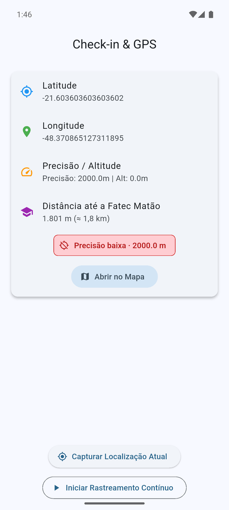 |
| **Abrir no Mapa** abriu o app do Maps com o pino em 21°37'03.6"S 48°21'44.3"W, as coordenadas da Fatec | Com a permissão **Approximate**, o Android entrega a posição com 2.000 m de precisão: Chip **vermelho** |

| GPS desligado durante o rastreamento | GPS desligado na captura |
|---|---|
| 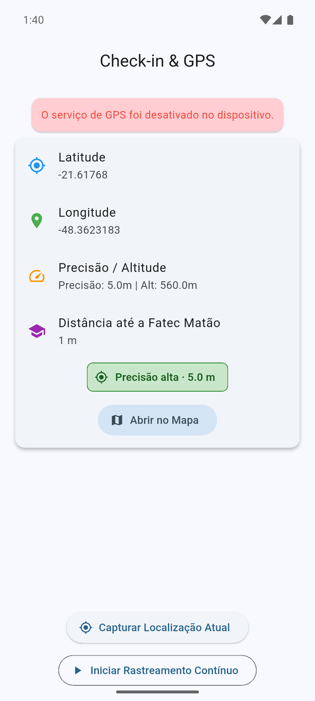 |  |
| Correção: o erro do stream vira aviso em português, o botão volta para **Iniciar** e a última posição fica na tela | Verificação do roteiro com `isLocationServiceEnabled()` antes da busca |

**Correção de layout** — celular na horizontal (cerca de 400 px de altura): a tela rola até os
botões, sem a faixa amarela e preta de overflow.

| Topo | Rolada até o fim |
|---|---|
| 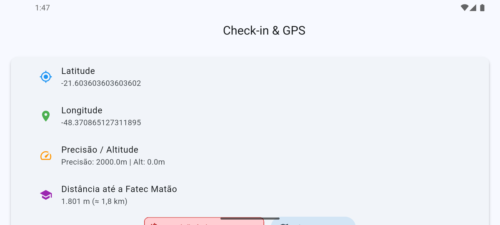 | 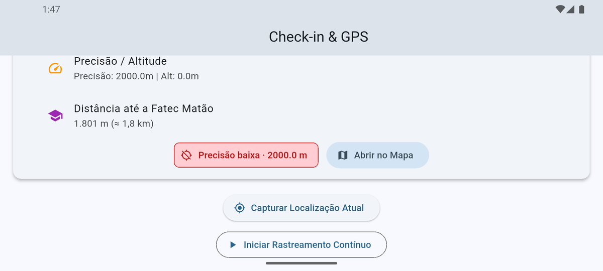 |

## Como executar

```bash
flutter pub get
flutter emulators --launch Pixel_7_API_35   # ou um celular Android com depuração USB
flutter run
```

Para mover o GPS do emulador, use **Extended controls › Location** ou:

```bash
adb emu geo fix -48.3658 -21.6033   # longitude, latitude
```

Só o Android foi executado. O `geolocator` também tem implementação para o navegador
(`flutter run -d chrome`), em que o próprio navegador pede a permissão, mas esse caminho não foi
testado aqui. Para rodar no Windows, o Flutter exige o **Modo de Desenvolvedor** ativo (os plugins
usam links simbólicos).

## Testes

São 29 testes. O GPS é simulado: os testes trocam `GeolocatorPlatform.instance` por um
`FakeGeolocator`. O app continua chamando os métodos estáticos do `Geolocator`, mas as respostas
vêm do fake: GPS ligado ou desligado, cada estado de permissão, a posição e um `StreamController`
no lugar do stream. O `url_launcher` é simulado do mesmo jeito, com `UrlLauncherPlatform.instance`.
O fake aplica o `timeLimit` com `Future.timeout`, igual ao `geolocator_android`.

| Grupo | O que é verificado |
|---|---|
| `LocationService` | GPS desligado, permissão negada (pede uma vez), `deniedForever` (não pede de novo), permissão concedida no diálogo, `LocationSettings` da captura e do stream, tradução dos erros |
| Tela do roteiro | Estado inicial, loading com botão desabilitado, card de erro sem o prefixo `Exception:`, stream atualizando o card e **Parar** cancelando a assinatura |
| Desafio Básico | Limites das faixas (14,9 / 15 / 50 / 50,1 m), cor e texto do Chip nas três faixas e troca de cor durante o rastreamento |
| Desafio Intermediário | Formatação, `distanceBetween` contra um valor calculado à mão (0,01° de latitude ≈ 1.113,2 m), card e recálculo pelo stream |
| Desafio Avançado | Formato do link, botão só com posição, `launchUrl` com o modo externo e `SnackBar` quando o link não abre |
| Correções | Permissão pedida antes do stream, GPS desligado no meio do rastreamento, captura sem resposta por 15 s, `setState` depois do `dispose` e layout em 360 × 480 e 360 × 800 |

```bash
flutter test
```

```
00:03 +29: All tests passed!
```

Os quatro testes de bug do grupo **Correções** também rodaram contra o código do roteiro (commit
do Desafio Avançado) e **falharam lá**: `setState() called after dispose()`, overflow de 200 px na
tela de 360 × 480, stream aberto sem pedir permissão e erro do stream sem tratamento.

## Ajustes em relação ao código do roteiro

- **`Colors.sky` não existe** no Flutter (erro de compilação). O tema usa `Colors.lightBlue`, o tom
  azul-céu mais próximo.
- **Versão do pacote:** o roteiro indica `geolocator: ^11.0.0`; o `flutter pub add` gravou
  `^14.1.2`. Na versão 14 o parâmetro `desiredAccuracy` de `getCurrentPosition` está obsoleto (o
  `flutter analyze` acusa), então a precisão foi para `locationSettings: LocationSettings(accuracy:
  LocationAccuracy.high)`, como no stream.
- **Plataformas Android e iOS:** o molde dos trabalhos cria só web e Windows, mas o roteiro pede o
  `AndroidManifest.xml` (e cita o `Info.plist`). O projeto foi criado com
  `--platforms web,windows,android,ios`.
- **Rastreamento sem verificação:** o roteiro abria `getPositionStream` direto. Sem permissão, o
  stream emitia erro e o botão ficava preso em **Parar Rastreamento**. Agora `monitorarPosicao()` é
  um `async*` que roda as mesmas validações da captura antes de repassar o stream (`yield*`).
  Qualquer erro encerra a assinatura e volta o botão para **Iniciar**.
- **Mensagens de erro:** as exceções do próprio `geolocator` (GPS desligado no meio do rastreamento,
  permissão revogada) vêm em inglês. `mensagemDeErroGps` traduz essas exceções.
- **Busca sem fim:** sem `timeLimit`, uma captura sem resposta deixava o loading girando e o botão
  desabilitado para sempre. Isso aconteceu no emulador com só a localização aproximada liberada. A
  captura única agora tem limite de 15 s e mostra um aviso para tentar de novo. O stream ficou sem
  limite: parado no lugar, com `distanceFilter` de 10 m, ele fica sem eventos, e isso não é erro.
- **Ciclo de vida:** `setState` depois do `await` só roda com a tela montada (`mounted`).
- **Overflow:** o `Spacer` numa `Column` fixa estourava em telas baixas (200 px a 360 × 480) com o
  card completo. A coluna agora fica num `SingleChildScrollView` com altura mínima igual à da tela
  (`LayoutBuilder` + `ConstrainedBox`) e `spaceBetween` no lugar do `Spacer`. Quando sobra espaço,
  os botões continuam no rodapé; quando falta, a tela rola.

## Histórico de commits

O versionamento segue o padrão de **commits semânticos** (Conventional Commits). Os dois primeiros
`feat:` usam as mensagens dadas no roteiro:

```
chore: inicializa projeto Flutter pdm_aula14_geolocalizacao
feat: configura permissoes de GPS e servico LocationService
feat: constroi interface de check-in com coordenadas e rastreamento em tempo real
feat: exibe Chip colorido conforme a precisao do GPS (Desafio Basico)
feat: calcula a distancia ate a Fatec Matao com Geolocator.distanceBetween (Desafio Intermediario)
feat: adiciona botao Abrir no Mapa com url_launcher para o Google Maps (Desafio Avancado)
fix: valida permissao antes do rastreamento, limita a espera do GPS e evita overflow e setState apos o dispose
test: cobre o LocationService, a tela do roteiro, os tres desafios e as correcoes com GPS simulado
docs: adiciona README com arquitetura e evidencias de execucao
docs: deixa claro no README que so o Android foi executado
```
